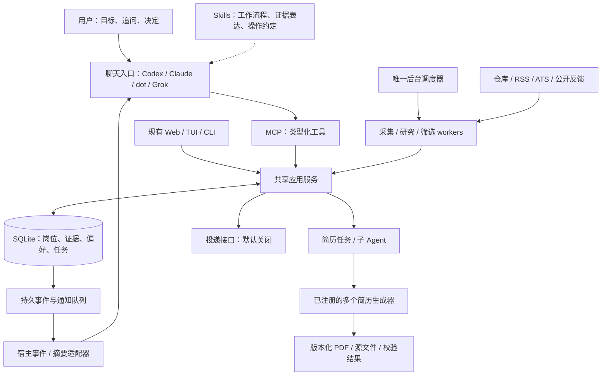

# 求职助手方案：独立服务、MCP 工具与可移植 Skills

日期：2026-10-09（America/Los_Angeles）。代码基线：`008bf87a47eb8b379216ba5eebe07197a5a6d46e`。

修订：纳入用户确认的多种自定义岗位、完整可行机会清单、快速只读脚本、多简历生成器与子 Agent，以及常开 Linux 主机。下文以这些要求为准，取代前稿“只给少量推荐”和“以后再考虑常在线节点”的假设。

实施约定：用户已确认当前设计并授权按计划逐步实现。优先可用功能和简单扩展点；先实现真实业务路径，通用事件平台、复杂权限体系、分布式租约和多层抽象按实际需求增加。保留不会误投递、丢失用户决定或把未知信息说成事实的基本正确性。无需每个可逆开发步骤再次确认。

状态：供审阅的产品与架构方案；没有实现、部署、安装插件、创建定时任务、真实采集或投递。代码结论来自静态阅读，平台能力来自当日官方文档，尚未验证用户账号的接入能力。前一份[代码审查与采集调优草案](2026-10-09-job-aggregation.md)继续作为底层改造依据。

## 1. 推荐的产品定位

把项目做成一个持续维护职位库、公司研究资料和岗位专用简历的个人求职助手。用户通过自然语言指定多个求职方向、查看完整增量、追问证据、调用简历生成器和记录投递；常开 Linux 后台负责持续采集、更新和恢复任务。

推荐组合：**独立 Python 求职服务 + 小而明确的 MCP 工具 + 可移植 Skills + 现成聊天宿主**。dot、Codex、Claude Code 或 Grok Bot 是可以适配的聊天入口。先完成一个入口，再验证第二个入口，避免同步维护多套聊天集成。

| 路线 | 能解决什么 | 局限与投入 | 建议 |
| --- | --- | --- | --- |
| 仅 Skill + 现有 CLI | 很快在聊天中查询、操作现有项目 | 持续执行、状态恢复、跨宿主记忆仍需应用解决；模型容易承担过多命令编排 | 作为迁移起点与兼容入口 |
| 求职服务 + MCP + Skills | 共享职位、证据、偏好、任务；复用聊天产品的交互和提醒 | 需补服务边界、持久任务和宿主适配 | 采用 |
| 自建独立 Bot 产品 | 完全控制聊天、移动端、通知和 Agent 生命周期 | 还需维护聊天状态、模型循环、账号、前端、推送与部署 | 有明确独立分发需求后再考虑 |

Skill 描述“如何完成求职工作”；工具提供明确动作；服务保存事实并执行任务。OpenAI 官方也将可重复工作流放在 Skill，把实时数据、授权和动作交给 MCP server。[官方职责说明](https://developers.openai.com/plugins/build/skills)

## 2. 用户体验与范围

示例交互，均为预期行为，不代表已经实现：

- “持续关注这些仓库和公司里的几种岗位。”每个自定义方向分别配置名称、标题别名、地点、级别、明确排除条件和可选简历生成器；一个岗位可以匹配多个方向。
- “把这两个 GitHub 职位仓库加进去。”助手检查来源格式与采集配置，展示来源与频率；确认后加入现有调度。首次采集返回任务 ID，完成后报告新增、更新、重复和失败。
- “今天有哪些值得看？”助手返回所有有可行性的新机会，并单列信息不足、仍值得核实的机会。按方向分组、排序与分页，展示总数和完整清单入口；不因排名低而隐藏。实质更新与重新开放另列。
- “A 公司面经和赞助情况怎么样？”跨多个已接入平台引用已保存材料；缺资料则提交研究任务。区分官方要求、历史记录和个人经历，说明检索覆盖与访问缺口，保留相反结论。
- “把这三份放进待投递；第一份我已经投了。”保存决定与人工已投记录，返回具体岗位 ID 和写入结果。
- “本周先暂停。”暂停后台任务的领取；正在运行的任务按安全检查点结束或取消，返回真实状态。
- “用生成器 A 给这些岗位准备简历。”创建持久父任务，按岗位分派生成子任务；每份产物与固定 JD、经历库和生成器版本关联，回报校验结果。
- 换一个聊天入口后，职位、偏好、阅读进度、简历版本和任务状态一致。Agent 可先运行一个只读 context 命令了解当前数据，再按需深入查询。

首版保留 CLI、TUI、Web、AI 筛选、人工反馈与评估、原有来源、手工队列和历史。Web 用于批量浏览与核对；聊天用于表达意图、解释和处理少量决策。自动投递保留现有适配接口，仍默认关闭，不暴露提交工具。

## 3. 现有代码能复用多少

| 代码事实 | 对本方案的意义 |
| --- | --- |
| `.claude/skills/` 已有 9 个 manager skills | 已有推荐摘要、决策、反馈、配置、筛选器维护和运维工作流，可迁移工具调用约定 |
| `pipeline.py:71` 的 `run_pipeline`、`select/engine.py:199` 的 `run_select` | 采集与筛选可以成为任务处理器，无需重写全部业务 |
| `select/review.py:61/94/118` 的 detail/decide/label | 详情、人工决定和反馈已有业务行为，应成为各入口共用的服务 |
| `select/setup.py:19` 的 `make_runner` | 可延续模型执行适配，不将整个服务锁定某一聊天平台 |
| `docs/step4-run.md:289`、`serve.py:359` | 当前只有“ask Claude Code”通知，未实现自动回到聊天的结果通知 |
| `serve.py:233/282/293` | 筛选额度等待会阻止采集；需要拆开任务依赖 |
| `serve.py:136` 的文件状态 | 原子替换能防止半文件，不能解决多个入口并发读改写覆盖状态 |
| `core/db/tables.py:237` 的 feedback | 是用户对筛选的标签；公开面经等资料必须另建 evidence 模型 |
| `process/job_browser.py:17` | 数据查询模块同时依赖 Textual，应逐步抽离，避免 MCP 查询加载 UI |

以代码和 `docs/step4-run.md` 的 as-built 部分为准。该文档早期设计包含 Slack、自动唤醒等设想，不应当作现成功能。

## 4. 分层与技术栈



| 部分 | 决定 | 理由 |
| --- | --- | --- |
| 业务语言与依赖管理 | 保留 Python 3.12、uv | 采集、解析和现有模块可复用 |
| HTTP / 浏览器 | 保留 httpx / asyncio / Playwright | API 来源优先轻量请求；需要浏览器的来源再加载浏览器 |
| 类型与契约 | 保留 Pydantic，新增结构化请求/结果 | CLI、MCP、Web 共享验证与错误语义 |
| 数据库 | 保留 SQLAlchemy / Alembic / SQLite WAL | 单用户、单节点足够作为起点；先改查询与事务，测量后再决定迁移 |
| 接口 | 保留 FastAPI；新增基于官方 Python MCP SDK 的薄适配层 | 服务函数直接调用现有业务，不通过 shell 转调 CLI |
| 后台任务 | Linux 上的 SQLite 持久任务 + worker | 不先增加 Redis/Celery；任务可恢复且便于审计 |
| 前端 | 保留 React / Textual，控制本轮 UI 范围 | 批量浏览仍有价值；可选聊天卡片后置 |
| 模型 | 延续 runner 抽象，研究 provider 单独适配 | 交互模型与批量筛选模型可以不同，预算仍统一记账 |

建议按实际调用逐步提取 `JobQueries`、`JobReviewService`、`TaskService`、`ResearchService`、`ConfigurationService`。先迁移 MCP 需要的行为，再让旧入口调用共享服务；保持命令名、JSON 字段、TUI undo 和 Web 行为兼容。

首版采用模块化单体。只有出现多用户隔离、多个写节点或经测量的数据库瓶颈，才评估 PostgreSQL/外部任务队列。暂不需要向量数据库和额外 Agent 编排框架。

## 5. 工具与 Skills 的具体边界

第一组工具使用结构化参数和分页结果，避免把整段 JD、全部日志或所有证据反复塞进上下文。

| 工具 | 职责与结果 |
| --- | --- |
| `search_jobs` | 按状态、关键词、公司、来源、时间分页检索；用于推荐、队列与历史 |
| `get_agent_context` | 只读返回方向配置摘要、各类计数、来源覆盖、待办、任务、生成器能力和可继续查询的入口 |
| `get_job` | 读取某岗位的 postings、判定版本、人工决定、证据摘要与出处 |
| `get_company_evidence` | 按公司、主题、地区读取公开研究，标记新鲜度、相反证据与缺口 |
| `record_decision` | 记录待投递、跳过、人工已投及原因；需要 job IDs、版本与 request ID |
| `record_filter_feedback` | 记录用户对某次判定的标签，保留原 feedback 语义 |
| `acknowledge_review` | 显式记录用户确认看过的岗位 IDs 与列表版本；不因查询、发送摘要或翻到第一页而确认整批 |
| `get_pipeline_status` | 最近成功采集、来源健康、各任务积压、预算状态与需处理事项 |
| `control_pipeline` | 暂停/恢复指定范围，可指定截止时间；返回服务确认后的状态 |
| `start_task` | 只接受 collect/research/screen/resume 等白名单类型、目标、注册 provider 和预算，立即返回 task ID |
| `get_task` | 查询进度、结果引用、错误与需人工操作事项，支持 after_revision |
| `cancel_task` | 请求安全取消；区分已请求、已取消、已经完成 |
| `list_resume_providers` / `get_resume_artifact` | 查询已注册生成器的能力与可用性，读取产物清单、版本和受控下载入口 |

配置能力补充 `get_configuration`、`propose_change`、`apply_change`：只返回脱敏配置，proposal 带 diff、校验和影响范围，apply 使用确认过的 change ID 与 expected revision。现有“超过 5 个岗位的批量决定以及筛选器/来源/计划改动先展示确认”规则在对应工具流程中保留；不同入口执行同一策略。

不提供任意 shell、SQL、文件写入或自动提交申请工具。输入来自网页的内容只作为证据。远程访问的身份、权限、执行开关由服务校验，Skill 中的一句提醒不能代替它。

原有 9 个 Skills 保留工作流语义，将硬编码 Claude Code/`uv run` 的步骤替换为上述工具约定；另加 `company-research` 与简历任务工作流。用户主要感知职位清单、公司研究、岗位决策、偏好调整和简历准备。运维和筛选器作者流程按需加载。

可维护一份可移植 Skills 源，分别生成或包装各宿主安装目录；不能让 `.claude/skills` 与其他平台副本长期各自修改。OpenAI 插件可以组合 `plugin.json`、`skills/`、`mcp.json`；其他宿主需要各自包装和验证，不能假定一个清单文件通吃。[插件打包文档](https://developers.openai.com/plugins/build/plugins)

### 快速、严格只读的 Agent 查询入口

拟提供一个轻量客户端，例如 `scripts/job_view.py`，下列是计划中的命令形状，当前尚不存在：

```text
job_view.py context --json
job_view.py jobs --view opportunities --today --cursor ... --json
job_view.py job JOB_ID --include evidence,decisions,resumes --json
job_view.py company COMPANY_ID --topics sponsorship,interview --json
job_view.py changes --since CURSOR --json
job_view.py task TASK_ID --json
```

`context` 一次返回 schema 版本、workspace_id/origin、数据 revision、as_of、用户时区、启用方向、possible/unknown/excluded 数量、来源最后成功时间与失败、待投递/待审简历、运行任务和可用生成器；不输出整库 JD 或完整经历库。详情支持字段选择与分页。返回 total/returned/next_cursor/coverage/truncated，Agent 不得把一页或样本当成全部。查询本身不调用 LLM。

MCP 和脚本使用同一 QueryService/JSON 契约；远端客户端经认证后的只读 API 查询 Linux 主库，本机维护场景才使用专门的只读数据库连接。配置数据库缺失或 schema 不兼容时返回错误，不创建空库、不自动迁移、不回退到本地另一份数据。

当前 `DbStore.__init__` 会初始化引擎并执行 Alembic upgrade（`core/db/store.py:72`），引擎会创建目录并设置 WAL（`core/db/engine.py:12`）；因此不能直接复用其初始化作为严格只读入口。新 QueryStore 禁止迁移、TTL 清理、隐式标已读、通知确认和触发研究，也不加载浏览器/模型/私密 profile。服务端使用只读连接及明确查询方法；读取本身不修改业务状态。SQLite WAL 读连接须满足 sidecar 文件条件，活跃主库不能伪装成 immutable；物理只读快照只用于明确标注时间的离线查询。[SQLite 只读 WAL 说明](https://www.sqlite.org/wal.html)

初始化开销、查询次数、返回字节数和 p95 查询耗时作为实测指标；不在未测量前保证毫秒数。索引与按需投影优先，全文查找再按实际需要增加。无需让 Agent 每次扫描表结构、下载主库或读取全部源码。

统一 changes cursor 覆盖职位更新、资格变化、人工决定、简历产物、归档与删除 tombstone；不能拿当前 CLI 的 `--since` 时间筛选冒充完整同步协议。不同数据库中的裸 job ID 可能相同，工具调用与链接均关联 workspace_id。阅读游标、通知送达和“已投递”分别保存；只读查询返回下一游标，由显式操作确认推进。

## 6. 持续运行、恢复与通知

### 后台只有一个采集调度权威

Linux 主服务决定来源何时采集、研究何时过期、哪些岗位需要筛选。聊天宿主的 schedule/routine 只拉取摘要，或提交有幂等键的请求。避免 `serve`、旧 schedule、host heartbeat 同时各跑一遍采集。主机支持 systemd 时由其维持服务进程，进程启动管理不参与业务排程；Mac 原有 launchd 入口保留兼容。

采集、研究、筛选使用独立任务与有限并发。模型额度耗尽时，筛选进入等待；采集在自己的预算和积压上限内继续。研究失败不变成“没有负面反馈”；证据不足显式进入待补充状态。积压达到上限时降低采集频率或暂停相应来源，并说明原因。

### 任务必须持久化

`tasks` 至少记录类型、目标、输入指纹、幂等键、状态、attempt、lease owner/until/generation、next_attempt_at、进度、结果引用、错误和 revision。状态包括 queued/running/retry_wait/waiting_for_usage/waiting_for_user/succeeded/failed/cancelled。

短事务原子领取任务；网络和模型调用在事务外执行；提交结果时检查租约代数。重启后回收过期租约，旧 worker 不得覆盖新结果。明确用户重试与网络重发的区别：相同 request ID 返回同一个任务；计划任务按来源、配置版本、时间窗口生成稳定键。

目标是至少执行一次、业务写入幂等。外部请求已完成但结果未落库的崩溃窗口仍可能产生额外请求或模型费用，不承诺 exactly-once。不要仅把目前 `serve.json` 包一层 MCP 就称为可恢复 Agent。

### 主动通知采用 outbox

结果写入与事件创建在同一事务；发送器重试投递，记录事件 ID、订阅、渠道、尝试次数和确认状态。用户选一个主要通知入口；其他入口照常查询，避免跨宿主重复提醒。若主动选择多个渠道，则每个渠道有自己的发送状态。

首批事件：新增可行/待核实机会、影响已收藏岗位的重要证据变化、简历生成完成、来源需要登录、持续失败和需要用户决定。无变化保持安静；安静时段聚合。推送可以简短，但必须给出总数和完整列表入口；日常摘要按用户指定频率递送，不额外触发全量重搜。

区分任务完成、事件被宿主接受、摘要已生成、消息可确认送达、用户已读。HTTP 成功或模型生成文字不能证明用户读到。支持送达回执时由适配器确认；不支持时记录 accepted/unknown，并保留用户主动拉取增量的能力。沿用原 `notified_at` 做迁移时也不能在仅生成草稿后就标记送达。

## 7. 职位、公开研究与记忆

### 多方向匹配与保留全部可行机会

方向（track）是用户可配置的数据，独立于某一来源、筛选器或简历模板。每个方向包含显示名称、标题别名/检索词、地区、级别、明确硬条件、软偏好、来源选择和默认简历 provider。岗位与方向是多对多关系；来源列表与定时采集尽可能复用，不能每加一个方向就无条件再抓同一份清单。

把资格判断、排序和人工决定拆开：

| 结果 | 规则 | 展示 |
| --- | --- | --- |
| possible | 至少一个启用方向有可行性，且无适用的全局硬排除 | 完整机会列表，可按偏好排序 |
| unknown | 无适用的全局硬排除，没有已确认可行方向，但仍有方向信息不足、未完成或出错 | 完整列表中的“待核实”，不能静默丢弃 |
| excluded | 有明确适用的全局硬排除，或所有启用方向均有证据排除 | 单独可检索的排除列表，展示理由与依据 |

聚合顺序固定为：全局明确硬排除 → 任一方向 possible → 尚有方向 unknown → 全方向明确排除。零启用方向或没有可评估方向时返回配置不完整/待匹配，不能利用空集合的“全部满足”把岗位排除。

对用户已明确不考虑的 senior 岗位，根据真实职级字段、岗位标题及 JD 佐证排除；JD 中出现“与 senior engineer 合作”不算 senior 岗位。“经验 preferred”、未写清级别、赞助未知或少一项技术栈属于软偏好或待核实，不能自动冒充完全不可能。年份、毕业窗口、地区和资格约束只有在用户目标明确、来源证据适用时才作为硬条件。

跨方向按 OR 保留：backend 不匹配而 data engineer 可行时仍显示；某方向报错不遮蔽另一方向已确认可行的结果。方向未适用不能误算排除。排序只决定顺序，不改变候选集合；被排除条目带 reason_code、证据、规则版本和人工恢复入口。

现有 `select/engine.py:109` 的 `decide_job` 在某方向缺失/错误时提前返回 None，且排除 unjudgeable 后才聚合；当前 fit/recommend=false 也不等于“完全不可能”。新增资格字段/判定关系，保留旧 step2、feedback 和人工 decision 的兼容显示。迁移后的完整机会视图不能只查 `state=recommended`；旧负向判断不能无证据直接迁为 excluded。

“今天”按用户 IANA 时区计算，以首次入库时间定义新发现，同时区分原始发布时间、重新开放、重要更新及因偏好变化新变得可行。跨来源同一岗位不重复算新机会。完整列表固定查询截止时间和匹配版本，分页使用稳定排序/结果快照；中途新增进入下一增量，防止翻页遗漏。首次改方向会产生旧岗位回填评估，单独显示进度，不假装是今天新发布。

来源覆盖和岗位新鲜度是列表的一部分：显示哪些来源成功、失败、未完成，不能把“抓取失败”报告成“今天零岗位”。停止抓取不证明岗位关闭。待核实/待处理条目不因旧 TTL 规则静默删除；归档保留检索与解释，原始载荷可按保留策略清理。人工已投/跳过默认进入历史视图，明确计数并可切回查看。

已抓到但解析失败的 posting 另列待解析数量与可用链接，不能让它在进入 jobs 前无声消失。“完整”限定为配置来源中本次已发现集合，并明确采集覆盖；预算、来源访问和互联网范围都不能支持“全网无遗漏”的承诺。用户说“不感兴趣”记录软偏好或个人决定，只有明确的资格纠正才更新硬排除规则；多方向反馈带作用范围。

### 多来源职位

来源范围包括 GitHub 职位仓库、公司 ATS、推荐网站（LinkedIn、Jobright、Simplify 等）和邮箱收到的推荐岗位。统一保存“发现渠道”和“实际申请地址”：同一岗位经邮件、网站、仓库多次发现时保留各自出处，再交现有去重流程关联。

邮件先做 `.eml` 标准文件导入形成可测试路径，再通过 EmailProvider 接 Gmail/Outlook/IMAP 的只读读取；每封邮件可能含多个职位，message ID 与每条链接分别标识，邮件主题不能冒充岗位标题。只提取指定推荐来源/标签范围，不发送、删除邮件或改变邮箱已读状态。真实账号接入需要用户提供/选择连接方式。

网站来源优先复用现有 LinkedIn 浏览器适配器；Jobright 先核实现有插件与实际页面，Simplify 区分 GitHub 清单和网站推荐页。推荐邮件/卡片没有完整 JD 时保留待补全记录，再访问官方职位链接补齐；不把某站暂时不可读伪装成已支持。解析器与获取方式分开，新增一种邮件供应商或页面获取方式不重写岗位存储。

首批用同一个 GitHub 结构化清单适配器接至少两个仓库，保留现有 ATS/LinkedIn。按实际源格式扩展 Markdown/CSV/RSS，优先读取源站结构化数据。每条 posting 保存原始来源、稳定 ID、仓库版本、官方申请 URL、抓取时间与内容指纹。

来源平台与雇主分开；已知 ID 内容改变时更新并重筛；跨来源同一个官方岗位合并并保留发现记录；不同官方 requisition 不因模板相同而合并。清单移除、抓取失败和官方关闭分别建模。HTTP 条件请求、限额、分页预算及详情补齐按前一份审查落地。

### 公开证据

保留 `public_evidence + evidence_links + research_cache`，覆盖 interview、sponsorship、recruiting_experience、listing_credibility。最低记录 URL、主题、短摘录或摘要、发布时间（可未知）、抓取时间、适用国家/岗位、关联依据和内容版本。

研究按公司/主题复用，岗位特有的要求再补充。先查现有资料，再获取新资料；先服务已入候选的岗位和用户追问，避免对所有抓到的岗位立刻做全面网络研究。

起步支持指定 URL 导入和少量可读取的公开来源，再接一个明确配置的搜索 provider。论坛登录、付费墙或无法读取的页面要标记覆盖不足。历史赞助记录不能等同于当前岗位愿意赞助；公司面经不能自动代表所有地区和团队；匿名负面反馈不作为无证据的硬淘汰条件。输出应是可核对的资料卡，保留分歧，不生成来源不明的公司总分。

跨平台研究返回 coverage：已检索平台/主题、时间范围、命中、无结果、访问受限和失败。相同经历的转载或互相引用只算一个证据族，不能用多个 URL 冒充多份独立佐证。不同公司同名、不同国家的同集团岗位、不同招聘年份分别关联；允许材料矛盾并说明适用范围。平台来源按 adapter 增加，不能宣称已经覆盖所有论坛。

### 持久偏好与事实

| 信息 | 权威位置 |
| --- | --- |
| 目标岗位、地区、工作方式、明确筛选要求、简报偏好 | 服务里的版本化用户偏好 |
| 岗位、公开材料、筛选结论、用户决定、人工已投记录 | 业务数据库，带时间和来源 |
| 从点击或跳过推断的偏好 | 独立建议，用户确认后才升级为明确规则 |
| 对话语气、临时讨论上下文 | 宿主聊天记忆 |

宿主读取当前偏好版本；切换聊天平台不丢事实。筛选输入引用固定职位/证据/偏好/筛选器版本；变化后有选择地重算未决岗位，人工决定和历史判断保留。

证据保留独立于岗位 TTL 和原始抓取清理：缓存过期触发刷新，不删除历史判定引用的必要摘录、出处和版本；岗位归档保留其解释依据。按明确保留策略清理未引用材料。用户要求删除相关证据时执行删除，并将历史解释标成证据已移除，不用新材料冒充当时依据。

偏好必须映射到实际执行规则：结构化条件进入查询/规则阶段，语义偏好作为版本化输入传给筛选器。现有 `command.md/filter.yaml` 逐个适配；偏好 proposal 同时列出受影响的规则和筛选器。若旧 prompt 与新偏好冲突，先展示冲突并解决，再应用；未完成映射时不能声称新偏好已经影响推荐。筛选器的专门规则可以补充明确偏好，不能悄悄覆盖它。

## 8. 模型与成本策略

聊天模型负责理解意图、解释和比较；规则处理格式、去重、缓存、状态机、频率与预算。后台仅对新增/变化岗位调用筛选模型，对公开材料缺口调用研究模型。公司级研究缓存和同 key 任务合并应先于“换更便宜模型”。

宿主能搜索网页不代表后台 Python 自动拥有同样的搜索能力；聊天订阅也不自动变成后端 API 额度。默认延续现有 runner 作为筛选入口，后台研究使用独立配置的 provider。接入时核对可用模型、认证和计费，不假定用户已配置。

现有 `select/filters.py:51` 默认允许每个筛选器直接 `web_search/web_fetch`，仅增加研究缓存不会自动消除这条重复研究路径。迁移后的默认筛选只消费已存证据，缺口返回 `research_needed`，由 ResearchService 完成后再续筛；需要即时检索的工具也必须经同一研究服务。旧筛选器逐个验证后迁移，过渡兼容模式保留原能力、单独标记其网络调用和用量，不宣称已经共享缓存。执行器无法提供准确用量时明确标记，不能把这一部分算作零成本或已精确受控。

未来可增加“宿主协助研究”：宿主调用自己的搜索工具，再通过受控导入工具提交来源和材料；服务仍校验来源、关联与去重，并区分宿主提供材料与服务独立核验。它是可选适配，不能成为关闭聊天后后台工作的隐含依赖。

采集、研究、筛选分别限额，共用服务端用量账本。付费任务先预留估计费用，完成后结算；未知费用明确为 unknown，估算上限不冒充外部账单绝对上限。保留模型、runner、输入版本和结果，避免换入口就重做同一批研究。

简历生成有独立并发、时间和用量预算，计入同一账本。公开研究拿公司与岗位上下文；私有经历材料只传给生成任务需要的执行器。先用便宜的确定性规则排除明确不适用项，给剩余全部机会保留可见记录，再逐步补研究与排序。

### 多简历生成器与子 Agent

生成器采用注册适配器复用现有仓库，项目负责调度和追踪产物。注册信息包括 provider ID、仓库/版本、固定 CLI/API/Skill 入口、支持的方向/格式、所需执行环境、校验能力和当前可用性。Agent 选择 provider ID，不能提交任意 shell 命令代替入口。实际仓库路径与接口尚待用户提供并核验。

任务输入固定为 job packet：job/posting ID、完整 JD 快照及 hash、官方链接、目标方向、用户明确偏好、允许使用的经历库版本/只读引用、模板和生成器版本、输出格式与目标目录。岗位事实和公开研究不能被写成用户经历；事实来源不足时列缺口，不能补造技能、指标或工作经历。

流程：用户指定岗位与生成器 → 持久父任务 → 每岗位/生成器组合一个子任务 → 生成 → provider 校验 + 产物验收 → 登记文件 → 用户审阅选定。默认在用户要求生成时执行；若以后启用“加入待投递后自动准备”，将其保存为显式偏好，避免给所有采集岗位自动生成简历。

子 Agent 是任务执行方式：已有 CLI/API 的生成器由 worker 调用；只有 Skill 的生成器通过已配置的 Agent runner 加载对应 Skill 和 job packet。部署必须验证该 runner 能在 Linux 独立启动、认证、恢复或重试，不能把当前聊天里的临时子 Agent 工具当作后台能力。暂时只能在 Mac 运行的 provider 可注册为远程 worker，离线时任务等待，并不影响 Linux 采集。

每个子任务使用独立工作目录和输出目录，经历库与母版为只读输入。不要让并行 Agent 修改同一仓库的母版、profile 或共享输出文件；需要改文件的旧生成器运行在任务级副本/隔离环境。先用有限并发，避免 LaTeX 编译和模型调用挤占查询与采集；不将一个岗位展开成无上限的多层 Agent。

产物 manifest 保存 artifact ID、job packet hash、provider/version、经历库/模板版本、文件 hash、格式、生成时间、校验结果和错误。记录实际源内容版本，不能只用可变 branch 名冒充版本。PDF 存在不代表合格：读取真实产物，检查编译结果、页数/溢出、文本提取、关键事实和渲染版式；不同 provider 的版式规则由其声明。

状态区分 draft、validated、needs_review、user_selected；子 Agent 不自行标记用户已确认。任务只有在产物落盘/上传、hash 校验和 manifest 登记完成后成功。跨聊天入口提供同一 artifact 的受控下载链接。JD 或经历库更新后给旧产物标记 stale，保留旧版；人工投递记录关联实际使用的 artifact，未知时明确记录未知，不能猜测。自动投递接口仍关闭。

成本比较使用同一组来源、岗位、目标与完成条件，记录真实请求、输入/输出及缓存 tokens、重试、人工干预和每份有用候选的费用。当前没有证据宣称某宿主更稳定、更便宜。

## 9. 常开 Linux 主机与聊天入口

用户已确认有常开 Linux，因此它作为首版生产主节点：唯一主数据库、任务队列、来源配置、研究缓存和简历产物都由它维护；Mac 和聊天宿主作为客户端。无需先购买云机器。尚未连接该主机，发行版、硬件、网络可达性与生成器依赖均未核验。

建议使用 uv 固定应用依赖，systemd 管理 API/MCP 服务、后台调度/worker 和按需启用的简历 worker。它们是同一项目的进程角色，共用本机状态；部署先明确哪些角色需要独立进程，不拆成多套微服务。浏览器和生成器按依赖需求使用独立环境，只有实际环境冲突时再容器化。[systemd 服务与重启配置](https://github.com/systemd/systemd/blob/main/man/systemd.service.xml)

| 部署项 | 业务需要与验收 |
| --- | --- |
| 启动与停止 | 固定服务用户、工作目录、运行环境和状态目录；开机启动、异常重启；停服务/取消任务时处理完整子进程组；租约负责恢复，不用进程重启冒充任务成功 |
| 时间 | 数据存 UTC，调度、截止日期和“今天”用显式 IANA 业务时区；验证夏令时与跨午夜，不能跟随 Linux 默认时区悄悄变化 |
| 唯一状态 | SQLite 留在 Linux 本地磁盘；Mac 通过 API/受控隧道访问，不挂载网络 SQLite、不维护另一份可写主库；离线副本必须标明 stale |
| 发布与目录 | 代码发布目录、持久状态、插件/筛选器、浏览器会话、任务输出分开；构建前端产物随版本发布；数据库迁移改为单独维护步骤，先备份再迁移，读脚本不能触发 |
| 可见性 | 显示每个来源最后成功抓取、各队列积压、模型/登录可用性、失败和磁盘余量；主机失联时客户端明确说不可用，不把旧结果当今天的数据 |
| 数据保护与恢复 | 用 SQLite 一致性备份，覆盖配置、规则、必要附件、artifact manifest 与简历文件；保存异机副本并试恢复。schema/code/artifact 版本一起记录，不能只备份 Git |
| 浏览器 | API-only 不启动 Playwright；确需浏览器的来源单独验证 Linux 依赖和登录维护入口。Mac session 不假设可直接搬到 Linux；某来源登录阻塞不阻止其他采集 |
| 简历资源 | provider 各用受控环境与独立工作目录；环境变量按需传递；并发、超时和资源配额以主机实测决定，保证查询和采集可用 |

现有 `serve install` 是 launchd 实现（`serve.py:448`），`core/notify.py:8` 在 Linux 不提供聊天推送；`AUTO_APP_HOME` 已存在，但 filters/plugins/migrations 还有源码目录依赖。这些均需适配，不能直接宣称“现有部署命令在 Linux 已可用”。

SQLite WAL 依赖同主机共享内存，不适合作网络共享文件。运行中备份采用 Online Backup API 等一致性方法，并将不可变简历文件与备份 manifest 校验对齐；恢复时核对文件 hash，缺产物不能报告可下载。[SQLite WAL](https://www.sqlite.org/wal.html)、[在线备份](https://www.sqlite.org/backup.html)

Playwright 的浏览器版本与 Python 包关联，Linux 还需要系统依赖；发布和升级时一并验证，不能只复制 Mac 虚拟环境。[Playwright 浏览器安装](https://playwright.dev/python/docs/browsers)

| 阶段/入口 | 具体方式 | 需要验证的边界 |
| --- | --- | --- |
| 首版：当前 Codex 或 Claude Code | 访问 Linux 主服务的 MCP/客户端 + Skills；已有 CLI 继续兼容 | 完成一个宿主的读、写、任务恢复与简历产物查询验收 |
| dot | 包装求职插件，连接受支持的 MCP 端点；可用时增加 MCP Events | 账号及工作区权限、网络可达、事件回调、实际提醒体验 |
| Grok Bot | 复用工具契约，适配其技能与 routine；以例行查询摘要作为保守起点 | 自定义 MCP 在所用 Bot 入口是否可用、认证与事件能力，不从 Grok 其他入口推断完全等价 |
| 独立 Bot | 仅当需要独立客户端、多人分发等明确需求时增加 | 承担自己的 Agent 循环、聊天和用户体系 |

官方能力核对：dot 可以连接电脑、使用受支持的应用/插件；访问本地电脑需要电脑在线且 ChatGPT app 开着，本地 Skills 也依赖连接电脑。[dot 电脑与应用](https://learn.chatgpt.com/docs/dots/computers-and-apps)

当前 OpenAI 文档提供适用于 dots 与指定 Work 环境的 MCP Events：用户授权订阅后，服务通过签名回调推送事件。该路径要求 MCP 2.0（`2026-07-28`）、持久订阅和出站 HTTPS；实现前检查选用 SDK 对该协议的支持，作为单独适配阶段，保留定时读取摘要的退路。[MCP Events](https://developers.openai.com/plugins/build/mcp-events)

Grok Bot 官方支持 Skills 与由 Bot 拥有的 routines，可在笔记本关闭时后台运行；Grok 的自定义 MCP 连接文档要求服务可达。两者不等于已经验证这个项目能在用户的每个 Bot 入口接通，需实测。[Grok Skills / routines](https://docs.x.ai/grok-bot/skills-routines-and-automations)、[自定义 MCP](https://docs.x.ai/grok/connectors)

本地 MCP 可以使用宿主支持的本地传输；接远程宿主时按宿主要求提供认证后的 Streamable HTTP，个人测试可以使用受支持的私有隧道。公共分发需要稳定 HTTPS 服务。每次私有数据访问或写入都由服务校验身份与授权；现有 localhost Web 不能直接当作已具备远程认证的服务。[MCP 服务部署](https://developers.openai.com/plugins/build/mcp-server)

Mac 访问 Linux 可先走受控私有网络或 SSH 隧道。远程聊天平台若无法访问该私网，再按其支持方式配置有认证的 HTTPS 网关/隧道；只验证一个平台后再扩展，不默认云端 MCP 客户端能进入家庭局域网。现有 localhost Web 的 Host/Origin 限制也需要保留或明确适配，不能仅改监听地址就称为远程可用。

只有依赖 Mac 本地登录态或 Mac 专用生成器的任务才派给 Mac worker；它离线时对应任务等待。Linux 继续公共来源采集、研究和其他生成任务。未来迁云时延续同一主库所有权和 API，不产生双主状态。

## 10. 实施顺序与验收

每批都交付用户可用的完整路径；不先做一个很大的通用 Agent 平台。按用户最新的“功能优先、逐步完成”，先交付下表第 1 批的轻量查询和服务配置；持久任务、MCP 与实际 Linux 部署移到确有业务调用的后续阶段。具体执行记录见 [第一批实施计划](../superpowers/plans/2026-10-09-agent-foundation.md)。

| 批次 | 交付 | 验收 |
| --- | --- | --- |
| 1. Linux 与只读查询基础 | 独立 QueryService、context/分页/详情脚本、薄 HTTP API、systemd 配置生成；自动投递保持关闭 | 查询不建库/迁移/改已读；遍历所有结果；不加载浏览器/模型；Linux 路径原样生成；不冒充已完成远程部署 |
| 2. 完整机会与多源聚合 | 可配置多方向、三态资格；两个仓库复用适配器；邮件文件导入再接邮箱；按站点验证读取；增量更新 | 一个方向可行另一个失败仍保留；senior 精确排除且可解释；赞助未知保留；最后一页可达；待解析/超 TTL/预算耗尽无静默遗漏；原人工决定和旧入口保留 |
| 3. 多平台研究 | 公开证据、coverage、公司主题缓存、版本化偏好与判定输入 | 同公司复用研究；转载不冒充独立证据；默认筛选不绕过缓存；偏好实际生效；来源失败与无结果区分；相反证据并存 |
| 4. 接入现有简历生成器 | 先一个 provider 和一个岗位端到端；再接第二 provider/并行子任务、产物查询 | 同一 job packet 可复现；母版/经历库不变；并行不覆盖；编译和产物真实验收；生成不改为已投递；人工投递可关联实际文件；JD 变化标记旧简历 stale |
| 5. 主动与跨入口体验 | 持久任务、最小 MCP、Linux 实际部署与备份恢复、outbox、完整清单链接、简历完成通知；再验证第二宿主 | 主机重启恢复任务；重复 request 不重复写；单调度；恢复备份可查询；通知可重试去重；无变化安静；两入口同一事实/偏好/产物/进度；Mac 离线不阻塞 Linux |

恢复测试在隔离测试库和 mock 外部服务中做：任务领取后中断、结果提交前中断、重复事件、429、公司别名冲突、配置版本冲突和两个入口同时操作。先运行仓库基线，再增加行为回归；依赖账号的真实接入单独记结果。

每批观察：来源成功率与时延、有效新增/更新数、错误合并和重复数、错误硬排除率、完整分页覆盖、unknown/待解析积压、证据覆盖/过期率、研究缓存命中、任务恢复与重试、只读查询耗时、简历验收成功率、人工干预与费用。先测基线，再定数值目标。推荐 precision 可继续看，但不能用它优化掉低排名的可行机会。

## 11. 业务上值得补充的闭环

1. **误排除复查。** 排除页可查可恢复；定期抽样检查 senior/经验/赞助规则是否误杀，所有新规则先在已知岗位样本上回放。
2. **关注岗位的重要变化。** 对已入队列的职位优先核验官方关闭、截止时间、要求变化；有明确时间才提醒，不推测截止日期。变化使旧简历失配时关联提醒。
3. **投递留档。** 记录申请时间、实际岗位版本、实际简历 artifact、备注；后续可加面试/拒绝/offer 状态。先把手工已投记录可靠关联，不扩成完整招聘 CRM。
4. **未处理机会与新机会分开。** “今天新增”和“你还没看完”分别可查；翻页或换聊天不会丢掉尾部岗位。消息已发送、用户已查看、用户已决定分别记账。

## 12. 当前决定与交付边界

建议做私人使用的求职插件，以用户常开 Linux 为唯一主节点。核心价值是完整保留多方向的可行机会、可追溯的跨平台研究、快速只读工具和已有简历生成器的子任务协作；保留现有技术栈与界面，再逐步验证不同聊天入口。

本次仅修订方案文档。未修改业务代码、数据库、配置或既有 Skills；未安装依赖、运行测试、创建自动化、连接 Linux/账号、读取简历生成器仓库、部署服务、提交申请、commit 或 push。
