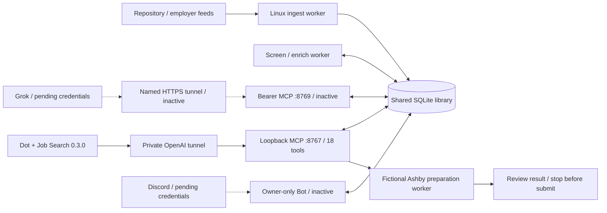

# Review remediation and live deployment — 2026-10-14

The owner authorized the reviewed fixes, Linux deployment, Dot tool updates and live readback,
plus a Grok Bot integration check. Existing uncommitted work is retained; no Git commit or push.

## Behavior fixes

- Enrichment/cache writes preserve structured country without replacing ingestion provenance.
  Country preferences inspect parsed/upstream/archive evidence, including mixed US/Canada roles.
- Ingestion reloads normalization input inside the writer transaction, so concurrent enrichment
  cannot have its requisition keys replaced by a stale projection.
- Negated/conditional rejection notices are not persisted as a rejection. Real negative-outcome
  phrases such as "not moving forward" still count.
- CLI and TUI manual applied actions persist the timeline atomically and idempotently. Legacy
  weekly counts use an existing submission/decision date where available, without invented dates.
- Backups verify frame completeness/checksum and available manifest SHA-256/size. Old no-manifest
  archives remain readable. Git deployment protects private paths independently of historical ignores.
- Experience rules use the strongest simultaneous requirement and preserve explicit alternative
  qualification routes; rule version changes so saved jobs are screened again.
- Job Search plugin 0.3.0 documents screening, sponsorship, milestones, pipeline/digest tools,
  confirmation-bound rule proposals, and unmatched-update review. Private Dot enables control tools;
  authenticated handoff tools remain separately opt-in.

## Verification and deployment

- Local full suite: **1,871 passed** (526.06 s). After the final mixed-location and negated-rejection
  boundary corrections, **278 related tests passed**. These are separate runs, not an additive total.
- Linux regression: **551 passed** (40.99 s), covering agent, tracking, operations, enrichment,
  screening, bot, ingestion and country/query boundaries. The only test warning was Python 3.12's
  upstream `audioop` deprecation from discord.py. Plugin packaging checks also passed.
- Previous source was saved at `~/Desktop/job-search/checks/review-deploy-20261014/previous-source.tar.gz`.
  Deployment used the current uncommitted source via rsync; schema is **8d4e0f2a5b31**. Existing
  feeds/preferences fingerprints were unchanged. There was no commit, push or historical-ref checkout.
- `auto-app-agent`, `auto-app-worker`, `auto-app-ingest`, `auto-app-preparation` and
  `job-search-tunnel` are active. The deterministic worker runs every 900 seconds with
  `screen,enrich,summary,health`; it has no `notify` step to avoid duplicate delivery when the bot is enabled.
  Its first round finished `ok` at 2026-10-14 07:24:43 UTC with zero consecutive failures.
  It screened 11,671 jobs, enriched 173 jobs and rescreened changed evidence. Final visibility was
  4,304 kept / 7,367 excluded. Enrichment reported 16 failed fetches and 2,496 unsupported candidates;
  those are coverage gaps, not a claim that all JDs were fetched. Discord summary was skipped because
  no webhook is configured.
- The live local MCP protocol exposes **18 tools**. Read context/status/rules/search/detail/digest
  and unmatched-update calls succeeded; an invalid milestone write was rejected without changing a job.
- Job Search **0.3.0** was uploaded and read back in the cloud UI. The connected backend schema
  refresh shows **8 read + 10 write tools**. Actual cloud `get_job_context`, `search_jobs`, and
  `get_job` calls succeeded against the new schema and returned screening/timeline data.
  This already-running Codex session still advertises its original six tools, so new control-tool
  invocation through that cloud session is not claimed; their Linux protocol calls and cloud discovery
  were verified separately.
- Main and preparation database backups both passed integrity and restore verification. Main backup
  restored 11,671 jobs with the current schema; preparation restored one existing run. Archives and
  proof files are under `~/Desktop/job-search/checks/review-deploy-20261014/verified-backups`.
  No backup timer was activated or database restored over production.
- Local evidence: `Search job/reports/2026-10-14-review-deploy/` contains cloud call proof and UI
  screenshots. Linux evidence: `~/Desktop/job-search/checks/review-deploy-20261014/` contains
  regression, MCP, backup, service and dependency checks. Logs contain no configured connector secrets.

## Discord and Grok preparation

The owner requested installation first and will fill secrets directly on Linux. Installed dependencies
include discord.py **2.7.1**, MCP **2.3.0**, and official cloudflared **2026.10.0** (release SHA-256 checked).
The binary is `~/Desktop/job-search/bin/cloudflared`.

`auto-app-bot.service`, `auto-app-agent-public.service`, and `job-search-grok-tunnel.service`
are installed, loaded, **disabled/inactive**. Their unit syntax and the example ingress rules passed
Linux validation. A preexisting unrelated `spice-vdagent.service` warning remains outside these units.
Missing credential/configuration gates skip startup. Only `.example` configuration files were installed;
no actual Bot token, webhook, MCP token, `grok.env`, tunnel YAML or JSON credential was created.
The optional failure-alert unit is installed and skips when its credential file is absent.

The [owner configuration checklist](../linux-connectors-setup.md) lists the four Discord values,
public MCP origin, independent Bearer secret, named-tunnel UUID/JSON and optional webhook, with paths
and start commands. The bot reads a mode-600 regular credential file. The public listener remains
loopback-only on 8769, requires Bearer authentication and does not enable handoff tools.

The signed-in Grok connector page has no Job Search connector; its custom form requests a name and
MCP URL. The static-Bearer authentication flow still needs acceptance after the owner supplies an
endpoint. No public tunnel was started, no Discord message sent, and no Grok call is claimed.
The existing Dot private outbound tunnel remains the only active cloud path.

## Deployed architecture and call paths

Dot/Grok use structured MCP calls; Discord uses slash commands/buttons against the same service layer.
Read tools query saved evidence, while explicit owner actions record decisions/milestones or control
screening. The regular ingestion/screening workers do not invoke models. The separate preparation
worker is opt-in, uses fixed fictional data and stops before submission.

## jd-resume-tailor recommendation

Keep durable JD snapshots, evidence-bank/build versions, artifact hashes, run state and job linkage
in project storage. Let the external agent select evidence and invoke the existing tailor Skill/scripts;
agent memory holds preferences only. The current tailor compiler already emits source/PDF hash build
reports; Search Job's `register_resume` accepts a Linux-local file under runtime/resumes. Cloud/local
artifact transfer and end-to-end provenance registration need an explicit adapter before they form
a working integrated workflow. This task does not implement that adapter or enable real submissions.
